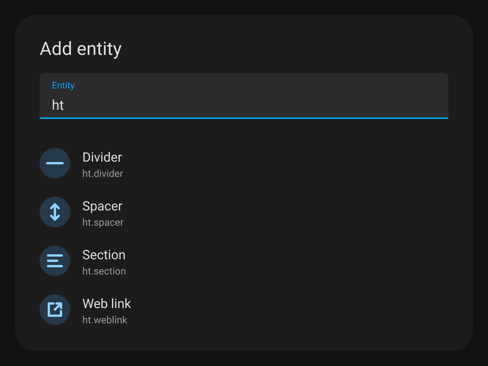
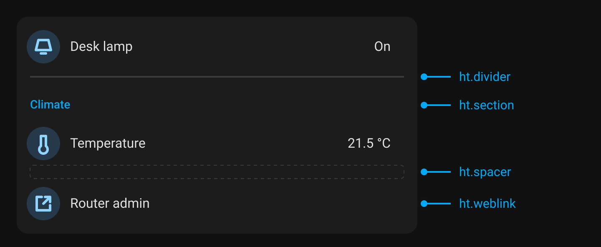

<p align="center">
  <picture>
    <source media="(prefers-color-scheme: dark)" srcset="custom_components/handytypes/brand/dark_logo@2x.png">
    
  </picture>
</p>

# Handy Types

Adds the extra row types of the entities card as real entities, so you can pick
them from the entity list in the dashboard editor instead of writing YAML.

Pick **Divider** from the list and you get the same result as:

```yaml
- type: divider
```

## What you get



| Entity | Same as | Set up on the row |
| --- | --- | --- |
| `ht.divider` | `type: divider` | Nothing to set up |
| `ht.spacer` | An empty gap between rows | Nothing to set up |
| `ht.section` | `type: section` | Name is the heading |
| `ht.weblink` | `type: weblink` | Name, URL and icon |

All entities use the `ht.` prefix, so typing `ht` in the entity picker filters down
to them. You can add the same entity as many times as you like.

Here is how they look in an Entities card:



## Install

1. Open **Settings > Marketplace** and choose **Add from link**.
2. Enter this repository (`owner/ha-handytypes`) and click **Add**. Choose
   **Integration** if asked for a type.
3. Search for **Handy Types**, click **Install**, and restart Home Assistant if
   prompted.
4. Go to **Settings > Devices & services**, choose **Add integration** and add
   **Handy Types**.
5. Hard refresh your browser once so the frontend module loads.

For a manual install, copy `custom_components/handytypes` into your
`custom_components` folder and restart.

## Use

1. Edit an **Entities** card.
2. Add an entity, type `ht` to filter, and choose Divider, Spacer, Section or Web
   link.
3. For a section or web link, click the pencil icon on the row. Set the **Name**
   (the heading or link text). A web link also has a **URL** box and can take an
   **Icon**.

Until a URL is set, a web link row shows but does not go anywhere.

If you prefer YAML, the same row looks like this:

```yaml
- entity: ht.weblink
  name: My link
  url: https://example.com
```

## Notes

- Works in the **Entities** card only. Other cards do not use row types.
- The rows are swapped in when the card renders, so the frontend module must be
  loaded (hard refresh after installing).
- The URL box is added to the row editor by the frontend module. If a future Home
  Assistant update changes that editor, the box may disappear; the YAML form above
  always works.
- These are state-only entities: they can't be renamed from the entity settings
  page.

## Licence

See [LICENSE](LICENSE).
